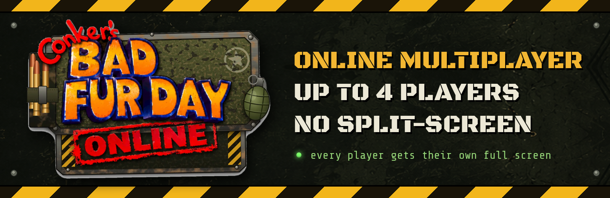

  

**CBFD Online** puts Conker's Bad Fur Day's multiplayer online: up to 4 players, each on their own PC with their own full screen. No split-screen.

- Every multiplayer mode from the game, played online
- 4 player co-op through the mansion, everyone as the character they picked
- Host or join from the launcher, with automatic updates
- A pause menu just for you, while the game carries on for everyone else

**[Download the latest release](https://github.com/cerealwalrus/cbfd-online/releases/latest)** (Windows), unzip it anywhere and run `ConkerOnline.exe`. You need your own US ROM of Conker's Bad Fur Day: this project contains no game data.

 

Built on <a href="https://github.com/sciaschi/CBFD-Recompiled">Conker's Bad Fur Day: Recompiled</a>. Includes the HD Icons texture pack from <a href="https://github.com/DahSidiAbdallah/ConkerBFDReloaded">Conker's Bad Fur Day: Reloaded</a>, with textures by <a href="https://github.com/GameBeast92/Conker-s-Bad-Fur-Day-4k-Ultimate-Texture-Pack">GameBeast92</a> (CC BY 4.0), modified.
